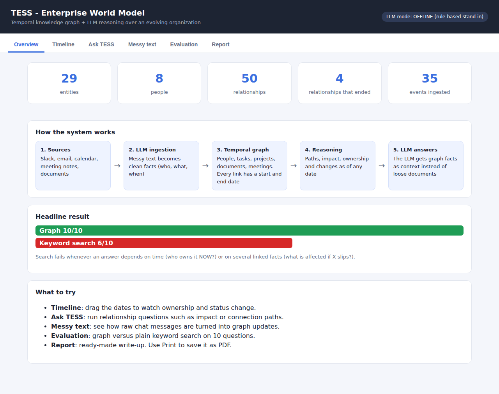
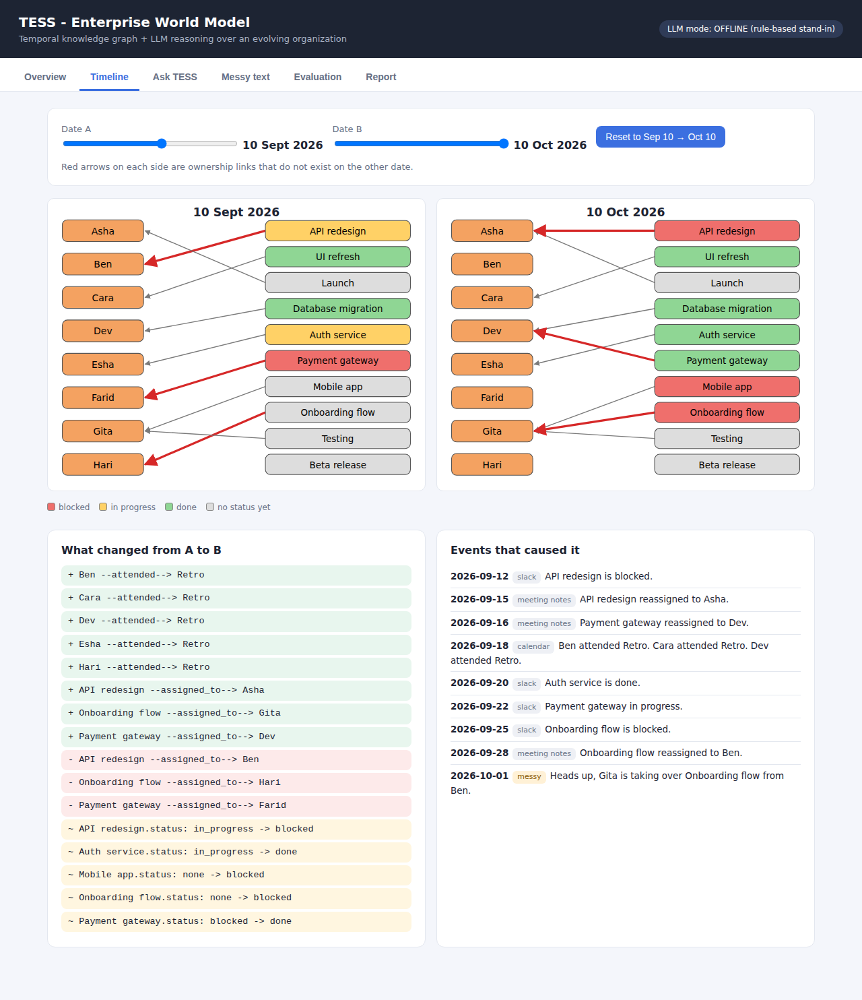
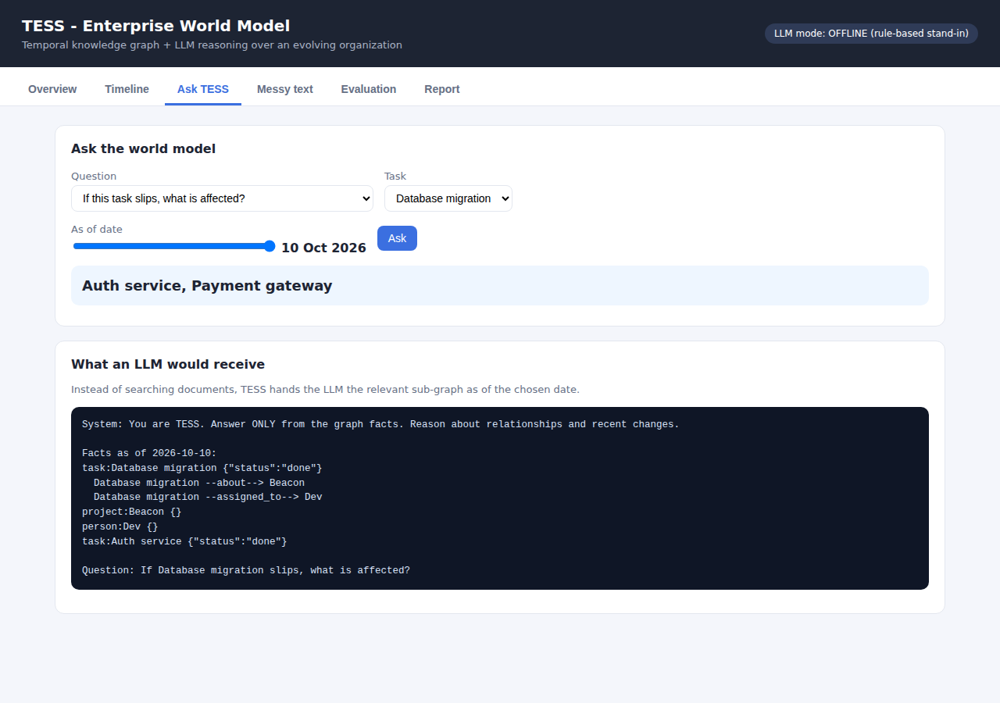
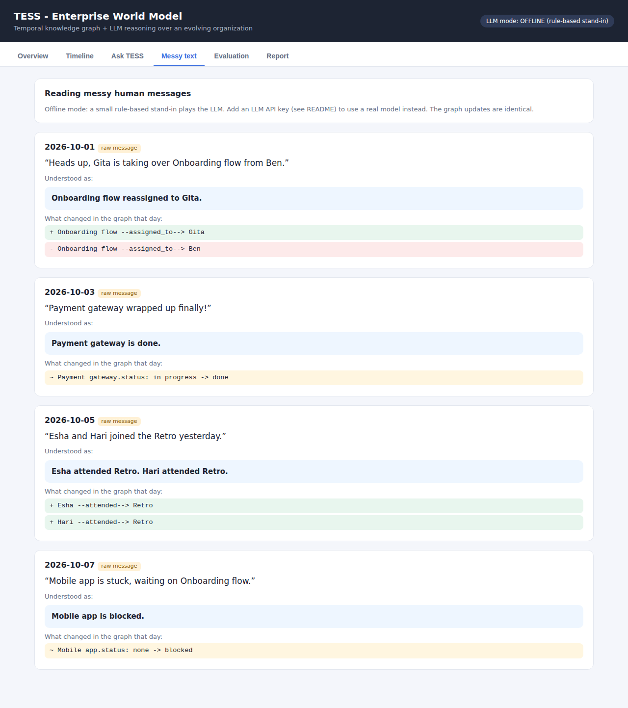
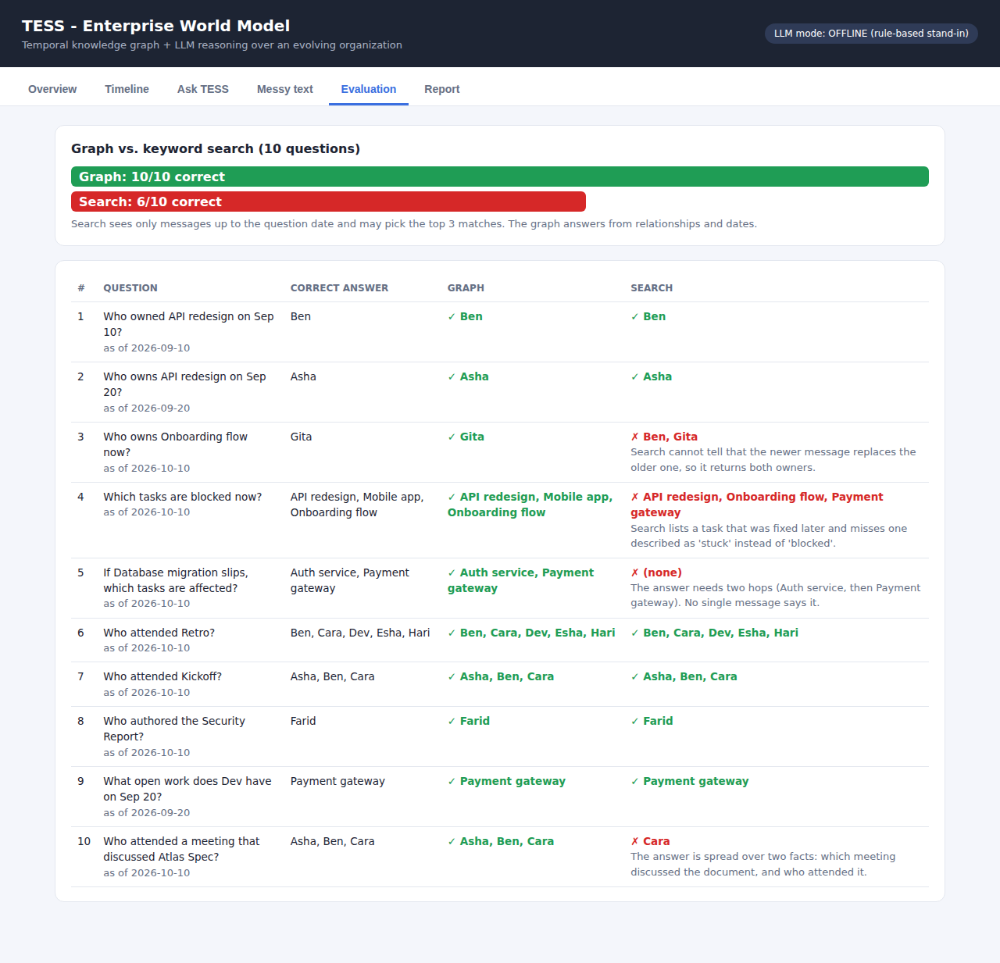
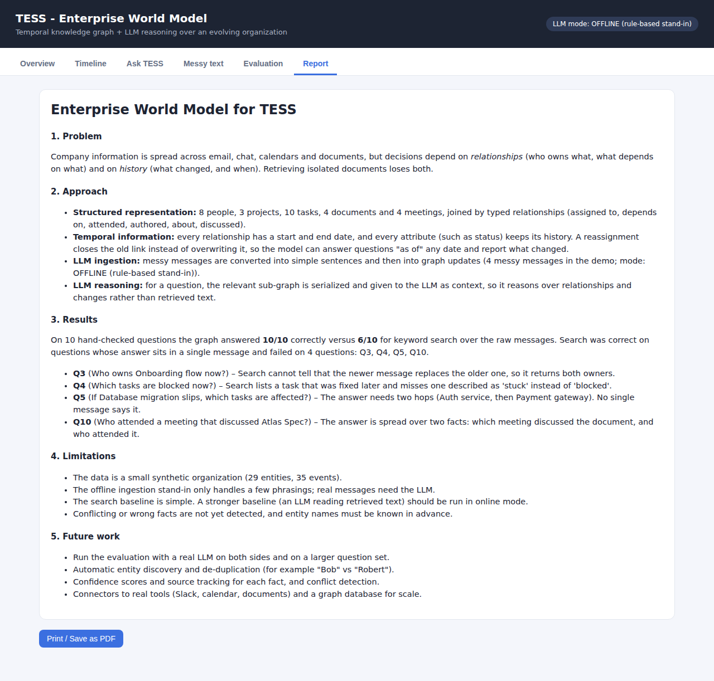
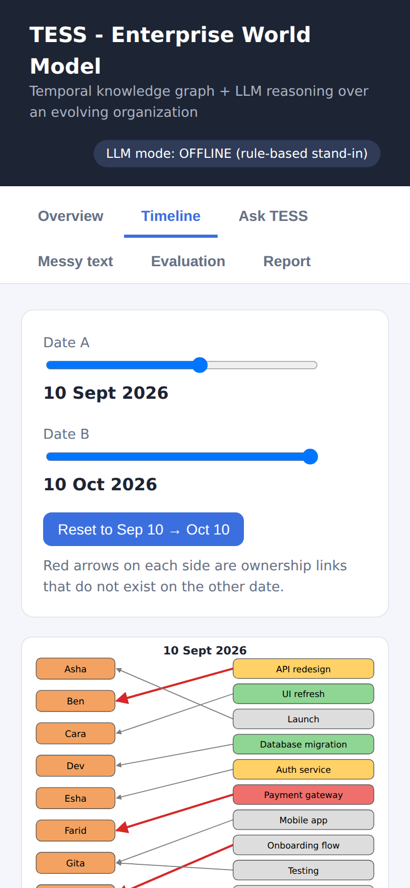
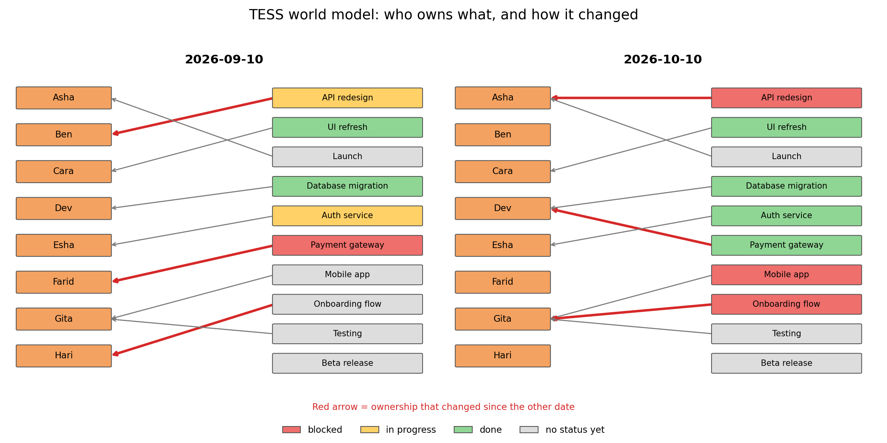
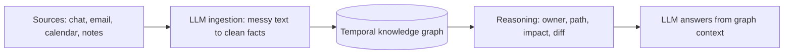

# 🕸️ TESS Enterprise World Model

### A temporal knowledge graph that lets an LLM reason over relationships and change

**Stop retrieving isolated documents.** TESS keeps a structured, evolving picture of an organisation (people, projects, tasks, documents and meetings) so it can answer *who owns this now*, *what breaks if it slips* and *what changed since last week*.


**[🔴 Live demo](https://vaishnaviwaghmare379-maker.github.io/tess-dashboard/)** · **[Quick start](#-quick-start)** · **[Features](#-features)** · **[How it works](#-how-it-works)** · **[Results](#-results)** · **[Screenshots](#-screenshots)** · **[Roadmap](#-roadmap)**



---

## ✨ Why a world model?

Enterprise information is scattered across chat, email, calendars and documents, but decisions depend on **relationships** (who owns what, what depends on what) and on **history** (what changed, and when). A search over loose documents loses both.

This project builds a structured representation of an organisation and investigates how **LLMs, knowledge graphs and temporal information** can work together to maintain an evolving organisational state.

> Project: **Enterprise World Model for TESS**. The system should let TESS reason over relationships and changes rather than retrieving isolated documents.

---

## 🚀 Features

|   | Feature | What you get |
| --- | --- | --- |
| 🧱 | **Structured organisation model** | People, projects, tasks, documents and meetings joined by typed relationships (`assigned_to`, `depends_on`, `attended`, `authored`, `about`, `discussed`) |
| ⏱️ | **Temporal edges** | Every relationship has a start and end date. A reassignment closes the old link instead of overwriting it |
| 📜 | **Attribute history** | Task status keeps every value with its date, so "what was blocked on Sep 12?" has an exact answer |
| 🗣️ | **Messy-text ingestion** | "Gita is taking over Onboarding flow from Ben" becomes a graph update |
| 🔗 | **Relationship reasoning** | Shortest connection path, downstream impact, open work per person |
| 🔄 | **Change detection** | A diff of the whole organisation between any two dates |
| 🤖 | **LLM-ready context** | A compact sub-graph serialisation to use as prompt context |
| 📊 | **Built-in evaluation** | 10 hand-checked questions: graph vs. keyword search |
| 🖥️ | **One-click dashboard** | A single self-contained HTML page with a timeline slider, live Q&A and a report |
| 🔌 | **Works offline** | No API key needed. Add one later to switch to a real LLM |

---

## 🖼️ Screenshots

| **1 · Timeline: who owns what, and what changed**  | **2 · Ask the world model**  |
| --- | --- |
| **3 · Messy text becomes graph updates**  | **4 · Graph vs. search evaluation**  |
| **5 · Built-in report**  | **6 · Mobile**  |

The same organisation on two dates. Red arrows are ownership links that changed:



---

## 🧩 How it works



1. **Ingest.** Raw messages are rewritten into simple sentences (an LLM, or an offline rule-based stand-in) and parsed into facts.
2. **Store with time.** Each fact becomes an edge with `valid_from` and `valid_to`. Exclusive relations such as `assigned_to` close the previous edge automatically.
3. **Query as of a date.** Every query takes a date, so the model can answer about the past as well as the present.
4. **Hand to the LLM.** `llm_context()` serialises the relevant neighbourhood so the LLM reasons over relationships and recent changes instead of loose text.

### Example

```
Q. Who owned the Payment gateway on Sep 10, and on Sep 20?
    2026-09-10: ['Farid']
    2026-09-20: ['Dev']

Q. If Database migration slips, what is affected?
    ['Auth service', 'Payment gateway']

Q. How is Hari connected to Atlas Spec?
     Hari --attended--> Budget Meeting
     Asha --attended--> Budget Meeting
     Asha --attended--> Kickoff
     Kickoff --discussed--> Atlas Spec
```

---

## 📈 Results

Ten hand-checked questions, answered two ways. *Search* is keyword retrieval over the raw messages (top 3), with a free advantage: it only sees messages up to the question date.

| Method | Correct |
| --- | --- |
| **Temporal knowledge graph** | **10 / 10** |
| Keyword search | 6 / 10 |

Search got the easy, single-message questions right and failed where it mattered:

| Question | Why search fails |
| --- | --- |
| Who owns *Onboarding flow* now? | Cannot tell that the newer message replaces the older one |
| Which tasks are blocked now? | Lists a task that was fixed later and misses one described as "stuck" |
| If *Database migration* slips, what is affected? | The answer needs two hops. No single message says it |
| Who attended a meeting that discussed *Atlas Spec*? | The answer is spread over two facts |

Full per-question output is in [`results/results.csv`](results/results.csv). Reproduce it with `python -m modules.evaluate`.

> ⚠️ This is a small synthetic organisation and an offline stand-in for the LLM. Use a real LLM key to run the stronger comparison (an LLM reading the retrieved messages) and read [Limitations](#-limitations).

---

## ⚡ Quick start

### 1. Clone

```bash
git clone https://github.com/vaishnaviwaghmare379-maker/tess-dashboard.git
cd tess-dashboard
```

### 2. Run the dashboard (no installs needed)

```bash
python dashboard.py
```

This builds the world model, runs the evaluation, writes `index.html` and opens it in your browser.

### 3. Other entry points

```bash
python -m modules.world_model     # small console demo
python -m modules.org_data        # six questions on the larger organisation
python -m modules.llm_layer       # messy text -> graph, plus an LLM context example
python -m modules.evaluate        # graph vs. search, writes results/results.csv
python draw_graph.py              # before/after picture (needs: pip install matplotlib)
```

### 4. (Optional) Use a real LLM

```bash
pip install anthropic
cp .env.example .env              # Windows: copy .env.example .env
# edit .env and set ANTHROPIC_API_KEY
```

The next run switches from **OFFLINE** to **ONLINE** automatically (shown in the dashboard header).
> 🔒 `.env` is in `.gitignore`. Never commit your key.

---

## 🛠️ Tech stack

| Layer | Technology |
| --- | --- |
| Language | Python 3.10+ (standard library only for the core) |
| Graph and time model | Plain dataclasses: `Entity`, `Edge` with `valid_from` / `valid_to` |
| Ingestion | Rule-based parser, plus an LLM rewrite step |
| LLM (optional) | Anthropic API |
| Dashboard | One self-contained HTML file: vanilla JavaScript and SVG, no build step |
| Hosting | GitHub Pages |

---

## 🗂️ Project structure

```
tess-dashboard/
├── dashboard.py              # one-click: build everything, write index.html, open it
├── draw_graph.py             # optional before/after picture (matplotlib)
├── index.html                # generated dashboard, served by GitHub Pages
├── modules/
│   ├── world_model.py        # temporal knowledge graph, queries and ingestion rules
│   ├── org_data.py           # synthetic organisation and dated events
│   ├── llm_layer.py          # messy text -> clean sentences, and LLM answers
│   └── evaluate.py           # graph vs. keyword search on 10 questions
├── results/results.csv       # evaluation output
├── docs/screenshots/         # images used in this README
├── requirements.txt
├── .env.example
└── README.md
```

---

## 🔌 Core API

| Method | Description |
| --- | --- |
| `add_entity(id, type, name)` | Add a person, project, task, document or meeting |
| `ingest(wm, text, date, source)` | Turn a sentence into graph updates |
| `owner(task, date)` | Who owns a task on a date |
| `open_work(person, date)` | Tasks assigned to a person that are not done |
| `path(a, b, date)` | Shortest relationship path between two entities |
| `impact(task, date)` | Everything that depends, directly or not, on a task |
| `diff(date1, date2)` | Edges and attributes added, removed or changed |
| `llm_context(entity, date)` | The entity's neighbourhood as prompt-ready text |

---

## ⚠️ Limitations

- The data is a small **synthetic** organisation, not real company data.
- The offline ingestion stand-in only understands a few phrasings. Real messages need an LLM.
- The search baseline is simple. A stronger baseline is an LLM reading retrieved messages.
- Entity names must be registered in advance. There is no automatic entity discovery or de-duplication.
- Conflicting or wrong facts are not yet detected.

## 🗺️ Roadmap

- [ ] Run the evaluation with a real LLM on both sides and on a larger question set
- [ ] Automatic entity discovery and de-duplication ("Bob" vs "Robert")
- [ ] Confidence scores and source tracking for every fact, plus conflict detection
- [ ] Connectors for real tools (Slack, calendar, documents)
- [ ] A graph database for scale
- [ ] Free-text question answering in the dashboard

---

Built for **Enterprise World Model for TESS** by [@vaishnaviwaghmare379-maker](https://github.com/vaishnaviwaghmare379-maker)

If this helped you, consider giving it a ⭐
